<p align="center">
  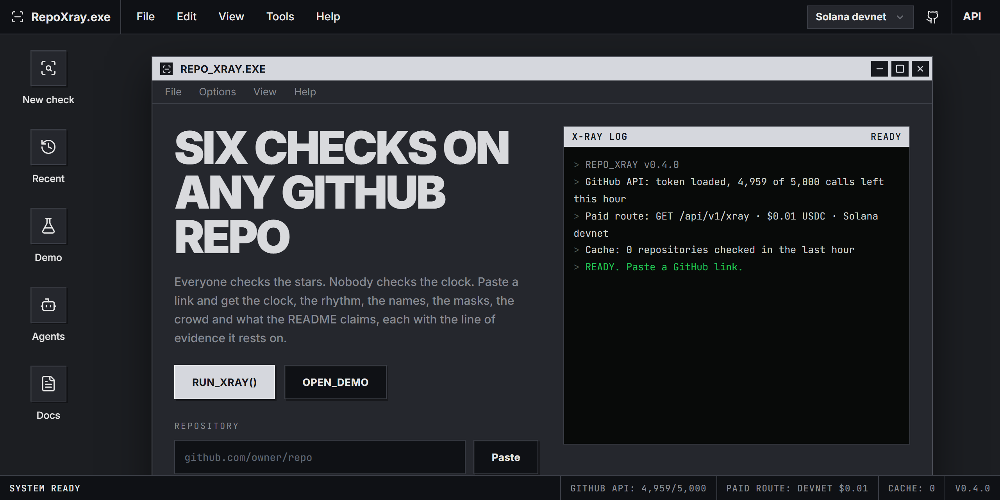
</p>

<h1 align="center">REPO X-RAY</h1>

<p align="center">
  <b>Paste a GitHub link. Get six checks on the repository, each with the line of evidence it rests on.</b><br>
  <sub>No verdict without a receipt. Unknown is not fake.</sub><br>
  <sub>A desktop app in the browser: a program window, a live log, a taskbar. Every number on screen is real.</sub>
</p>

<p align="center">
  
  
  
  
  
  
</p>

<p align="center">
  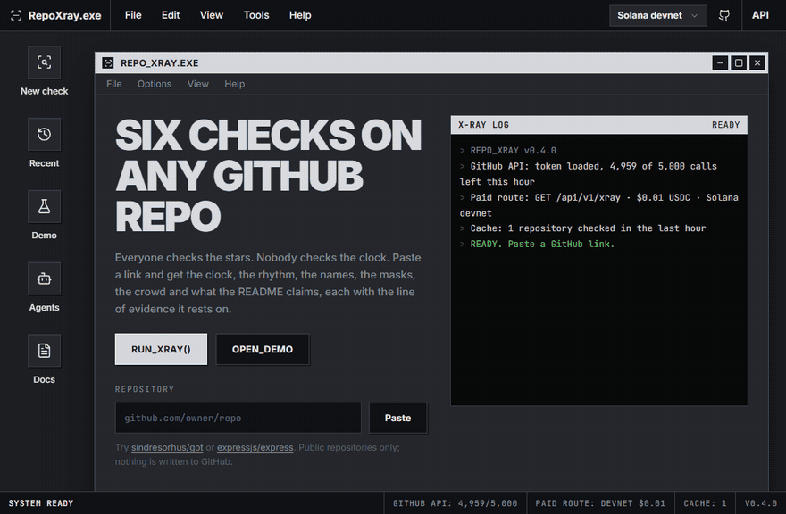
</p>

<p align="center"><sub>The repository in this recording is <b>synthetic</b>: built by <a href="demo/make-staged-demo.mjs"><code>demo/make-staged-demo.mjs</code></a> to look staged. No such project, account or person exists.</sub></p>

---

## Why

A GitHub link is a launch now. Traders decide in a minute from the stars, the commit count, the forks and the README:
the numbers that are cheapest to fake. Commit dates are set by whoever commits. Co-authors can be names typed into a
config. Forks and pull requests can arrive from accounts made the same afternoon.

REPO X-RAY reads the parts that are hard to fake together: when the history starts against when the account and
repository were born, how the commits are spaced, whose names sit on which addresses, which GitHub id is really
behind the commits, how the crowd arrived, and whether the README's promises exist in the code.

## The log

The log panel prints only what is true: the server's state at start (GitHub calls left this hour, the paid route,
the cache), then the request, then one line per check and the grade. The taskbar keeps the same numbers.

<p align="center">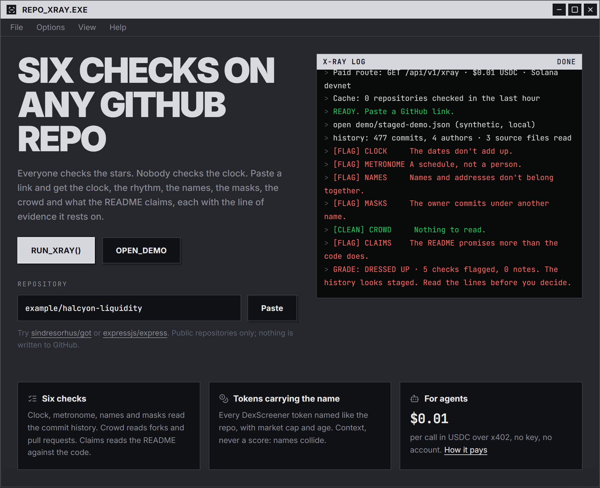</p>

## Two reports

<table>
  <tr>
    <td width="50%" valign="top">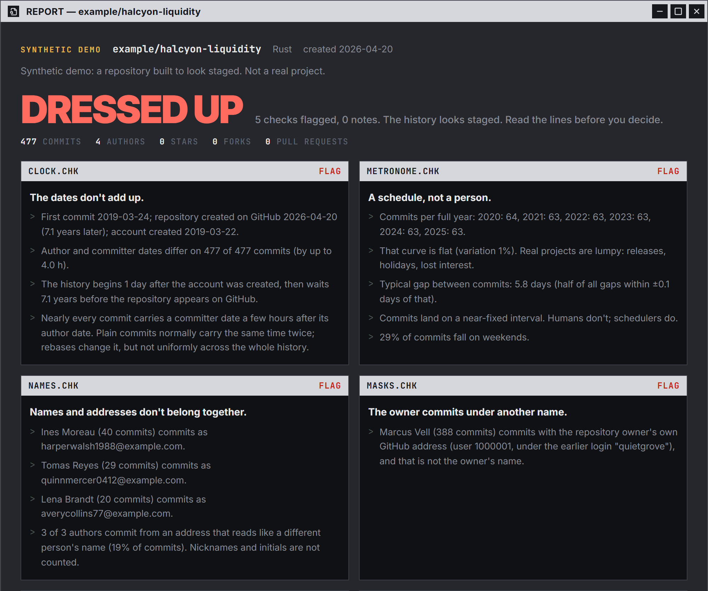</td>
    <td width="50%" valign="top">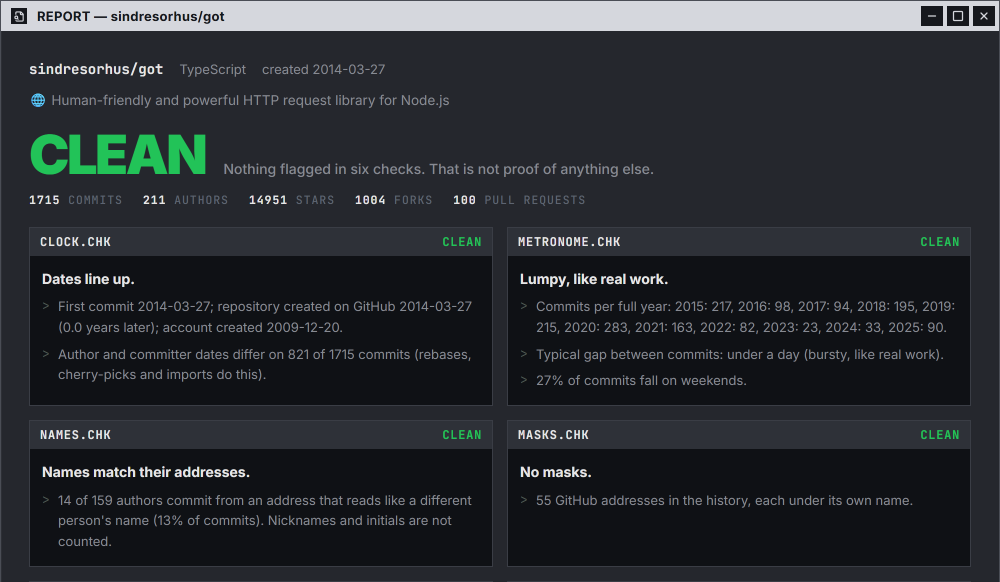</td>
  </tr>
  <tr>
    <td align="center"><b>DRESSED UP</b> · synthetic demo<br><sub>477 commits from 2019, one every 5.8 days, persona co-authors, the owner under another name, a README that promises money moves</sub></td>
    <td align="center"><b>CLEAN</b> · <a href="https://github.com/sindresorhus/got">sindresorhus/got</a><br><sub>lumpy years, bursty days, 211 authors, nothing flagged</sub></td>
  </tr>
</table>

## The six checks

<p align="center">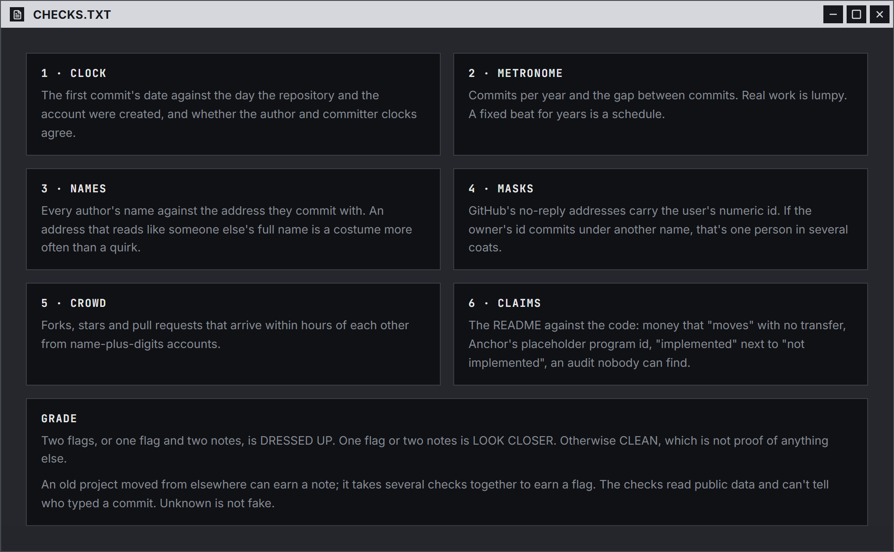</p>

| | Check | Reads | Flags when | Evidence line it prints |
|---|---|---|---|---|
| 🕰️ | **Clock** | first commit vs repo and account creation; author vs committer time | history starts days after the account, then waits years to appear on GitHub | *First commit 2019-03-24; repository created on GitHub 2026-04-20 (7.1 years later); account created 2019-03-22.* |
| 🥁 | **Metronome** | commits per year, gap between commits | ≥ 3 full years within 12% of each other, or a near-fixed interval | *Commits per full year: 2020: 64, 2021: 63, 2022: 63, 2023: 63, 2024: 63, 2025: 63.* |
| 🪪 | **Names** | every author's name against the address they commit from | most authors commit from an address that reads like *someone else's* full name | *Ines Moreau (40 commits) commits as harperwalsh1988@example.com.* |
| 🎭 | **Masks** | GitHub no-reply ids (`<id>+<login>@users.noreply.github.com`) | the owner's own id commits under a name that is not the owner's | *Marcus Vell (388 commits) commits with the repository owner's own GitHub address (user 1000001, under the earlier login "quietgrove").* |
| 👥 | **Crowd** | the newest 100 forks, pull requests and stars | half of them land within 4 hours from name-plus-digits accounts | *N of M forks arrived between HH:MM and HH:MM UTC; K of them from accounts like name1234, …* |
| 📜 | **Claims** | the README against the code, program ids against the chain | money "moves" but nothing transfers; Anchor's placeholder program id; "implemented" next to "not implemented" | *The program id in programs/halcyon/src/lib.rs is Fg6PaFpo…, the placeholder from Anchor's project template.* |

Every example line except Crowd's comes from the synthetic demo; Crowd has no forks to read on a local repo, so its
line shows the format.

**Grade:** two flags, or one flag and two notes, is **DRESSED UP**. One flag or two notes is **LOOK CLOSER**.
Otherwise **CLEAN**, which is not proof of anything else. Evidence lines print only for checks that score.

### Tokens carrying the name

Under the checks: every token on DexScreener whose name or symbol matches the repository's name or README title,
with market cap, 24 h volume and age. Context, never a score: names collide.

<p align="center">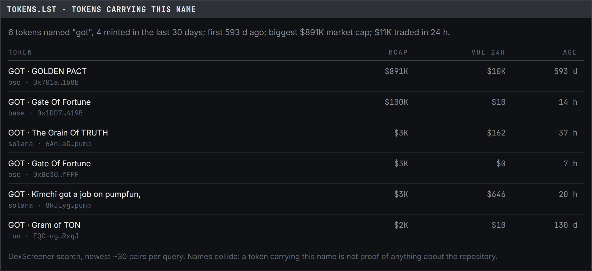</p>

## How it works

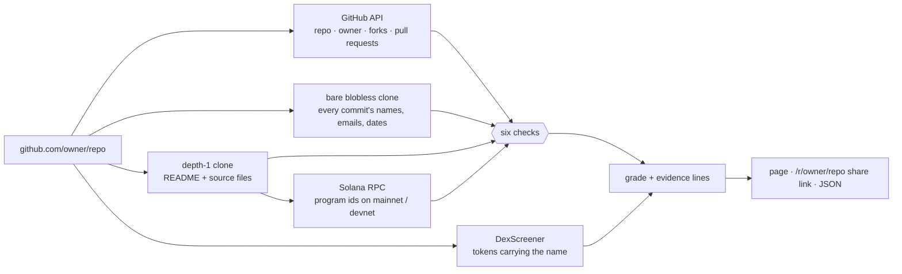

Nothing is written to GitHub. Both clones are deleted when the check ends. Results are cached for an hour.

## For agents: $0.01 a call over x402

<p align="center">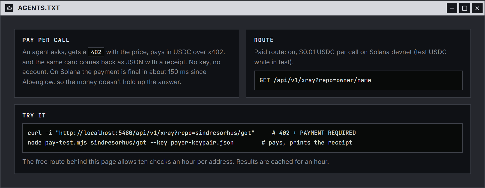</p>

`GET /api/v1/xray?repo=owner/name` is behind [x402](https://x402.org) v2, scheme `exact`, USDC on Solana. No key and
no account: the agent asks, gets a `402` with the price, pays, and the same card comes back as JSON with a receipt.
Since Alpenglow, a Solana payment is final in about 150 ms, so the money doesn't hold up the answer.

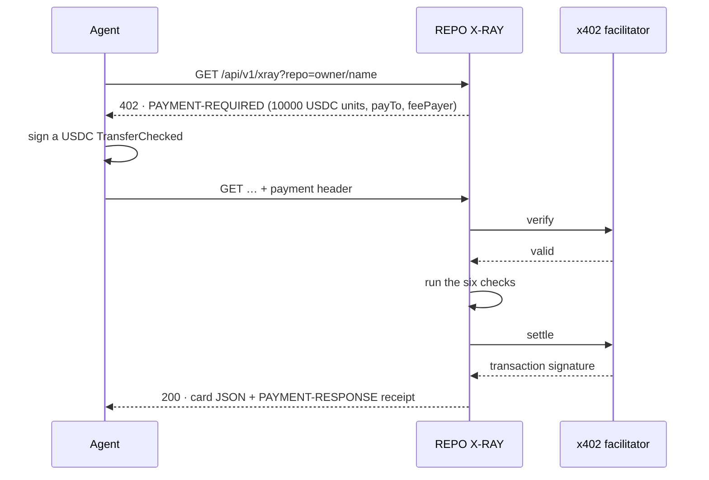

```bash
curl -i "http://localhost:5480/api/v1/xray?repo=sindresorhus/got"   # → 402 with the price in PAYMENT-REQUIRED
node pay-test.mjs sindresorhus/got --key payer-keypair.json          # pays, prints the receipt and the grade
```

| | devnet (default) | mainnet |
|---|---|---|
| network | `solana:EtWTRABZaYq6iMfeYKouRu166VU2xqa1` | `solana:5eykt4UsFv8P8NJdTREpY1vzqKqZKvdp` |
| USDC | `4zMMC9srt5Ri5X14GAgXhaHii3GnPAEERYPJgZJDncDU` (test) | `EPjFWdd5AufqSSqeM2qN1xzybapC8G4wEGGkZwyTDt1v` |
| facilitator | `https://x402.org/facilitator` | `https://facilitator.payai.network` |
| payTo | `node setup-devnet.mjs --payer funded-devnet-keypair.json` makes a receiver and its USDC account | your wallet, which must already hold a USDC token account |

Config lives in `xray.config.json` or env (`XRAY_NETWORK`, `XRAY_PAYTO`, `XRAY_PRICE`, `XRAY_FACILITATOR`). With no
`payTo` the paid route answers 503. The free route behind the page allows 10 checks an hour per address.
The payer needs USDC on the chosen network and no SOL: the facilitator pays the fee. Devnet USDC comes from Circle's
faucet (faucet.circle.com).

> **Status (v0.4.0):** the 402 challenge and the client's signed payment are proven on devnet. The facilitator rejected
> the test payment because the payer held no devnet USDC, so a settled paid call has not been seen yet.

## On a phone

<p align="center">
  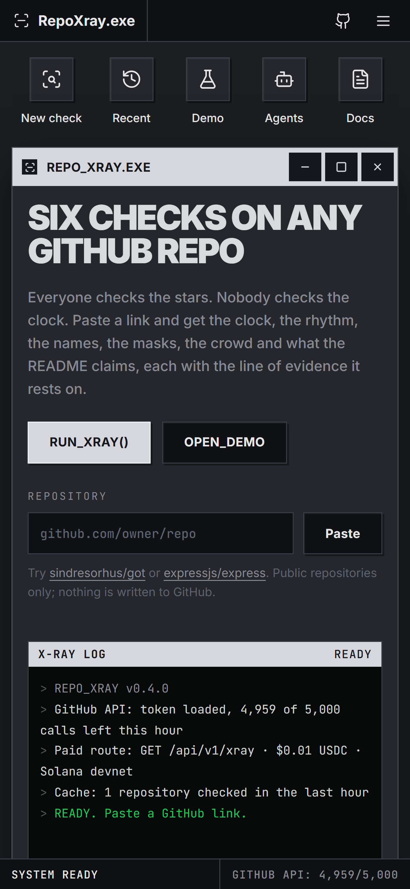
  &nbsp;&nbsp;
  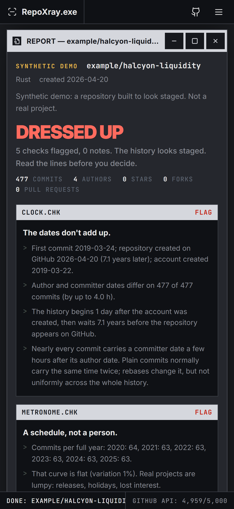
</p>

## Calibration

The thresholds were set against honest repositories chosen for their *kinds of mess*, so the checks don't cry wolf.

| Repository | Shape of mess | Grade |
|---|---|---|
| [sindresorhus/got](https://github.com/sindresorhus/got) | one owner, squash merges | ✅ CLEAN |
| [madler/zlib](https://github.com/madler/zlib) | 1990s project pushed to GitHub later | ✅ CLEAN · 1 note (old history, newer repo) |
| [expressjs/express](https://github.com/expressjs/express) | organisation created after the history | ✅ CLEAN |
| [jqlang/jq](https://github.com/jqlang/jq) | organisation created after the history | ✅ CLEAN |
| [morluto/rea](https://github.com/morluto/rea) | very popular, 100 forks an hour | ✅ CLEAN |
| [nirholas/pumpfun-github-claims](https://github.com/nirholas/pumpfun-github-claims) | README about other people's money | ✅ CLEAN |
| [paidhubdotfun/paidhub](https://github.com/paidhubdotfun/paidhub) | drives someone else's program | ✅ CLEAN |
| [nirholas/pump-fun-sdk](https://github.com/nirholas/pump-fun-sdk) | no README | ✅ CLEAN · 1 note |
| `example/halcyon-liquidity` | **synthetic**, built to look staged ([demo/](demo/)) | 🟣 DRESSED UP · 5 flags |

How the thresholds were found, including the false alarms on the way: [learnings/](learnings/).

## Run it

```bash
npm install
node server.js                          # http://localhost:5480
node server.js --check owner/name       # one result as JSON, no server
```

A GitHub token lifts the API limit from 60 to 5,000 requests an hour: set `GITHUB_TOKEN`, or the server borrows
`gh auth token` at start (read-only, never logged).

**Rebuild the demo and the images**

```bash
node demo/make-staged-demo.mjs
node server.js --check-local demo/staged-demo --meta demo/staged-demo.meta.json > public/demo/staged-demo.json
node docs/capture.cjs                   # needs Playwright's Chromium and the server running
```

The page shows the demo at `/?demo=staged` (or the Demo icon), labelled SYNTHETIC DEMO on the report.

## What it reads

- A bare, blobless clone (`git clone --bare --filter=blob:none`) of the default branch: every commit's author and
  committer name, email and date.
- A depth-1 clone for the Claims check: the README and up to 4,000 source files (≤ 512 KB each, no lockfiles, no
  `node_modules`/`target`/`dist`).
- GitHub API: the repository, its owner, the newest 100 forks and pull requests, up to five user lookups for no-reply
  ids. GitHub's star list needs more token scope than `gh` gives, so Crowd says when stars were unavailable.
- Solana JSON-RPC `getAccountInfo` on mainnet and devnet for program ids in `declare_id!` or `Anchor.toml`.
- DexScreener's keyless search for tokens carrying the repo's name.

Repositories over 300 MB and forks are refused with a plain message.

## Files

| Path | What |
|---|---|
| `server.js` | express: the page, `/api/xray` (free, limited), `/api/v1/xray` (x402), `/api/recent`, `/api/health`, `/r/owner/name` |
| `checks.js` | the five history checks, pure functions |
| `claims.js` | the Claims check (README vs code) and the token lookup |
| `public/index.html` | the page: a desktop-app shell (menu bar, desktop icons, windows, log, taskbar), icons from Lucide |
| `pay-test.mjs` · `setup-devnet.mjs` | a paying x402 client · devnet receiver wallet + USDC account |
| `demo/` | the synthetic staged repository's generator and metadata |
| `docs/capture.cjs` · `docs/img/` | the README's screenshots and GIF |
| `learnings/` | how each slice was calibrated |
| `version.txt` | bump with every change |

## Limits

- It reads public data. It can't tell *who typed* a commit, only what the dates, ids and names say together.
- A CLEAN card means nothing on this list fired. It is not an audit.
- An old project moved from another system can earn a note. It takes several checks together to earn a flag.
